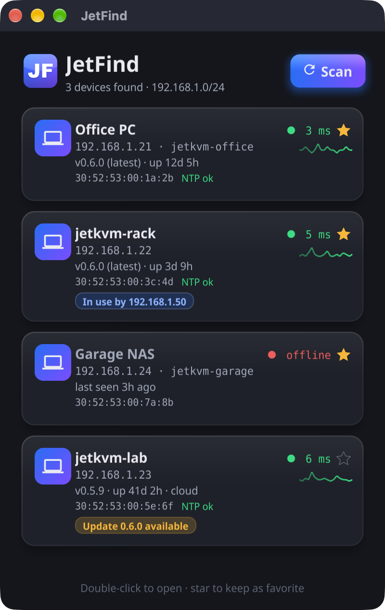

<p align="center">
  
</p>

<h1 align="center">JetFind</h1>

<p align="center">
  Find every <a href="https://jetkvm.com">JetKVM</a> on your local network and open it with a double-click.
</p>

<p align="center">
  
</p>

## What it does

JetFind scans your local network for JetKVM devices and lists them, so you don't have to remember IP addresses. Double-click a card to open that JetKVM's web UI in your default browser.

Each card shows live status, refreshed every 5 seconds:

- **Ping**: connection time to the device, with a small graph of recent values. Green under 30 ms, yellow under 150 ms, red above.
- **Firmware version**, marked `(latest)` or with an **Update available** badge, checked hourly against [JetKVM's GitHub releases](https://github.com/jetkvm/kvm/releases).
- **Uptime** since the JetKVM software last started.
- **In use by …** when someone has an active remote session open, and from which IP.
- **MAC address**, read from your computer's ARP table.
- **Clock sync**: `NTP ✓` when the device's clock is synchronised.
- **Not set up** for devices that haven't completed first-time setup, and **cloud** when JetKVM Cloud is connected.

## No login needed

JetFind only reads information that a JetKVM exposes without a password: `GET /device/status` and the Prometheus endpoint `GET /metrics`. It never logs in, and that is deliberate:

- A JetKVM keeps one login token at a time, so logging in from JetFind would log you out in your browser.
- The detailed device data (video, USB, network settings) is only available inside a remote session, and opening one would disconnect whoever is using the KVM.

## How it finds devices

1. It lists the IPv4 networks of your active network interfaces. VPN tunnels are skipped, and networks larger than a /22 are narrowed to the /24 around your own address.
2. It tries port 80 on every address, 64 at a time.
3. Anything that answers is asked for `/device/status`. A JetKVM answers with `{"isSetup": …}` and either a `jetkvm` SKU or a page titled `JetKVM`.

A typical home /24 network is scanned in about 2 seconds.

## Install (macOS)

Download `JetFind-<version>-macos.zip` from the [latest release](https://github.com/Stigern/JetFind/releases/latest), unzip it and move `JetFind.app` to Applications. The app is a universal binary for Apple Silicon and Intel Macs.

The app is not notarized by Apple, so the first launch is blocked. To open it, go to System Settings › Privacy & Security and click **Open Anyway**. Or remove the download quarantine in Terminal:

```bash
xattr -dr com.apple.quarantine /Applications/JetFind.app
```

## Build from source (macOS)

Requires [Go](https://go.dev) 1.27 or newer and the Xcode command line tools.

```bash
git clone https://github.com/Stigern/JetFind.git
cd JetFind
./build-mac.sh
open JetFind.app
```

The first time it runs, macOS asks whether JetFind may find devices on your local network. Choose **Allow**, or no devices will be found. You can change this later in System Settings › Privacy & Security › Local Network. While macOS is still waiting for your answer, JetFind keeps retrying instead of reporting an empty network.

`build-mac.sh` installs the [`fyne`](https://docs.fyne.io) packaging tool if needed, builds `JetFind.app`, adds the Local Network usage description that macOS requires, makes it a universal binary (Apple Silicon + Intel), and signs it ad hoc.

### Windows and Linux

The code is cross-platform ([Fyne](https://fyne.io) GUI, Go standard library networking), but only the macOS build has been tested so far. Fyne needs cgo and a C compiler, so build on the target OS with `fyne package --os windows` or `fyne package --os linux`, or use [fyne-cross](https://github.com/fyne-io/fyne-cross).

## Development

```bash
go test ./...                      # scanner, metrics parsing, version and MAC helpers
JETFIND_DEMO=1 go run .            # sample devices, no network access (used for the screenshot)
go run ./tools/makeicon Icon.png   # regenerate the app icon
```

| Path | Contents |
| --- | --- |
| `main.go` | Window, scanning flow, live refresh |
| `card.go` | Device card |
| `effects.go`, `shaders.go` | Status dot, ping graph, slide-in, GLSL shaders for the card panel and the Scan button |
| `theme.go` | Colour palette and Fyne theme |
| `scan/` | Network scanning, JetKVM detection, `/metrics` parsing, GitHub release check, ARP lookup |
| `tools/makeicon/` | Icon generator |

JetFind is an independent project and is not affiliated with JetKVM.
